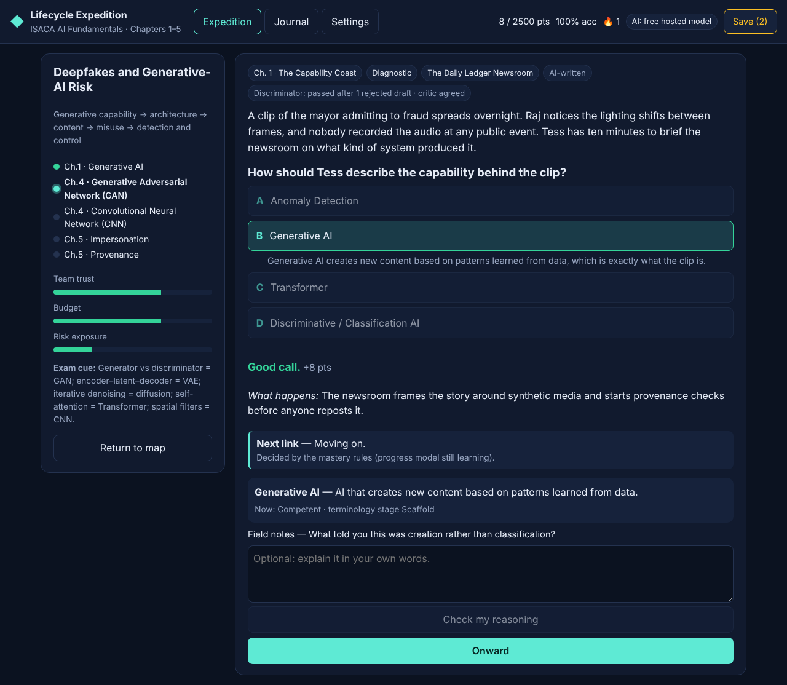
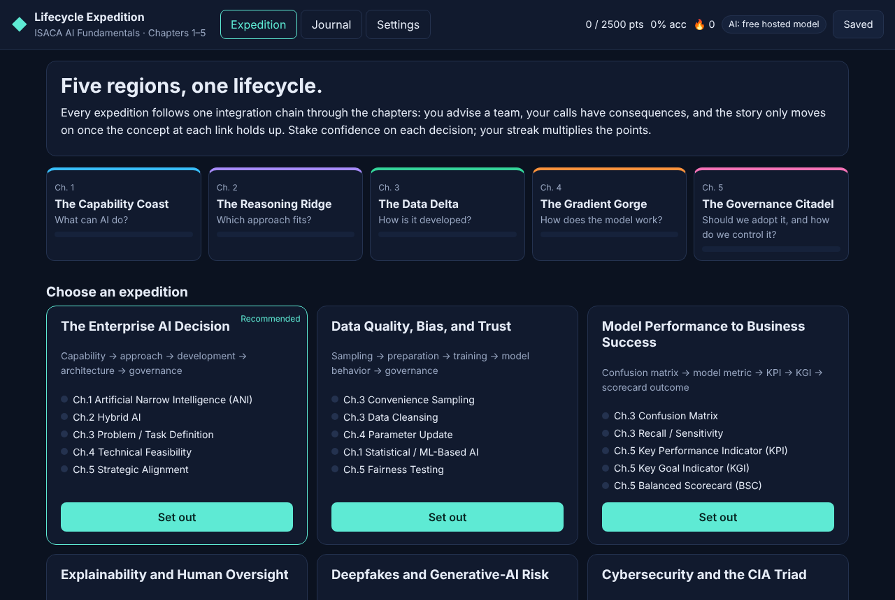
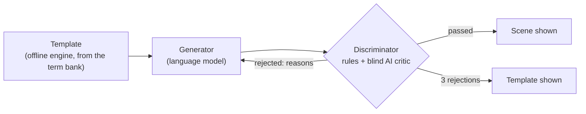

<div align="center">

# ◆ Lifecycle Expedition

### An AI-driven adventure for studying ISACA AI Fundamentals, Chapters 1–5

**[▶ Play it: bpforbes.github.io/ISACA-AI-fundamentals-interactive-learning](https://bpforbes.github.io/ISACA-AI-fundamentals-interactive-learning/)**

[](https://github.com/BPForbes/ISACA-AI-fundamentals-interactive-learning/actions/workflows/deploy-pages.yml)


[](LICENSE)

</div>

You advise a team through a real-world AI decision. Every choice has a consequence in the story, the story only moves
on once the concept at each step holds up, and an AI writes the scenes while a second layer checks them against the
exam definitions. It is not a quiz; it is the whole AI lifecycle, played.

<p align="center"></p>

---

## Contents

- [How it plays](#how-it-plays)
- [Getting a powerful AI for free](#getting-a-powerful-ai-for-free)
- [How scenes are made: a GAN-inspired loop](#how-scenes-are-made-a-gan-inspired-loop)
- [Knowing when to move on: rules + LSTM](#knowing-when-to-move-on-rules--lstm)
- [Saving your progress](#saving-your-progress)
- [Development](#development)

## How it plays

<p align="center"></p>

| | |
| --- | --- |
| 🗺️ **Five regions, ten expeditions** | Each expedition is one integration chain from the study guide, such as *confusion matrix → model metric → KPI → KGI → scorecard*. Every scene tests one **anchor** concept and draws on other chapters only to explain it. |
| ⚖️ **Decisions with consequences** | Choices move the team's trust, budget and risk. What happens carries into the next scene. A miss keeps the concept in play, asked from a new angle. |
| 🎓 **A tutor that adapts** | The teaching mode follows your evidence: Diagnostic for new terms, Contrast drills for near-miss confusions, Calculation drills for metrics, Integration once a term is in natural use, Remediation after repeated misses. |
| 🔥 **Points that mean something** | Points = Base × Confidence stake × Topic bonus × √streak. Stake 0.25×–4× on each call; stakes above 1× cost points on a miss. Points never mark a topic as mastered. |
| 🧭 **Two kinds of progress** | Mastery level (Unknown → Mastered) and the terminology ladder (Introduce → Scaffold → Conversational use → Transfer, or Recovery when it slips). |
| ⛺ **Camp every six scenes** | A short look back (score, accuracy, rematch queue, what comes next) and the natural moment to save. |
| 📓 **Journal** | Every term with its level, stage and forecast, plus your end-of-session study context as YAML. |

## Getting a powerful AI for free

The game works with no AI at all (the offline engine writes scenes from the term bank), but scenes are far better
from a large model. In **Settings → Scenario AI**, **Auto** picks the strongest one that is ready, in this order:

| Order | Option | Model size | Cost | Set up |
| :-: | --- | --- | --- | --- |
| 1 | **Free hosted model** (recommended) | Large: `openai/gpt-oss-120b` on Groq by default | Free tier, no card | Get a free key from [Groq](https://console.groq.com/keys), [Google AI Studio](https://aistudio.google.com/apikey) or [OpenRouter](https://openrouter.ai/keys), paste it in Settings, press **Load model list** |
| 2 | **In-browser model** (WebLLM) | 1B–8B, runs on your GPU | Free, fully private, no key | Settings → pick a model → **Download and cache** (1–5 GB once, needs WebGPU). It is kept on your device and loads automatically on every later visit |
| — | **Ollama** | Whatever you run locally | Free | `ollama serve`, then choose Ollama in Settings |
| 3 | **Cloudflare Workers AI** (last resort) | 8B by default | Cloudflare free allocation, then paid | Deploy the [`worker/`](worker/README.md) backend |
| 4 | **Offline engine** | No AI | Free | Always on |

Provider notes:

- **Groq**: about 1,000 free requests a day on `gpt-oss-120b`, and very fast. The best default.
- **Google Gemini**: Flash-Lite models get the most free requests; full Flash is stronger but has a small daily cap.
  Outside the EEA, UK and Switzerland, free-tier prompts may be used to improve Google products.
- **OpenRouter**: only `:free` models are listed; about 50 free requests a day without credits.

The in-browser model is downloaded once and kept in the browser's cache storage (the app asks the browser to keep
it persistent), so later visits load it from disk with no download. **Remove this model** in Settings frees
the space for one model; **Uninstall local AI** removes every downloaded model and WebLLM's files (study progress,
settings and keys stay). Ollama models are removed with `ollama rm <model>`.

Free tiers and model names change often, so the app reads each provider's live model list rather than hard-coding
it.

**Keeping your API key safe.** By default the key stays in your browser and is sent only to the provider. If you have
connected the cloud backend, **Upload to cloud vault** stores it there instead: encrypted with AES-256-GCM under a
Worker secret, never sent back to any page, and removed from your browser. Your Worker then adds it to each request
itself, so a copy of your browser's storage no longer exposes the key, and any device signed in to your backend can
use it without typing it again. Details are in [`worker/README.md`](worker/README.md#api-key-vault). Either way,
use a key you can revoke.

## How scenes are made: a GAN-inspired loop



1. **Template.** The offline engine builds a scene for the step straight from the term bank. It is the "real"
   sample: always faithful to the exam wording, but plain.
2. **Generator.** A language model rewrites it into a richer story in the expedition's setting, keeping the correct
   concept and the kind of near-miss distractors.
3. **Discriminator.** Rules check that the answer key expresses the definition, the story does not give the answer
   away, exactly one choice is the concept, and the wrong choices are real course concepts. Then an optional AI
   critic answers the question blind; if it picks a different choice or finds a contradiction, the draft is rejected.
4. **Feedback.** Rejected drafts go back with the reasons, up to three rounds, before the template is used.

> **Why "GAN-inspired" and not a GAN?** A GAN *trains* a generator and a discriminator against each other. Here
> nothing is trained adversarially: the generator is a fixed model and the discriminator is fixed rules plus a
> second model call. It borrows the generator-versus-discriminator structure, not the training. Calculation scenes
> always use the template so the arithmetic is exact.

## Knowing when to move on: rules + LSTM

After each answer the game decides whether to move to the next step or confirm this one from a new angle. This is
a **hybrid AI**: explicit rules plus a learned model.

- **Rules** (always on): a miss never moves on; after a miss, two correct answers in a row are needed; a step is never
  held for more than two confirmations, and anything still shaky goes to the rematch queue.
- **LSTM progress model**: a small LSTM trained in a Web Worker on your own answer history predicts, per concept,
  whether your next answer will be right and whether you are improving, steady or declining. It joins the decision
  only after beating a running-accuracy baseline on your newest answers, which it was not trained on. While it is
  in use, a correct answer waits for one more confirmation if the model gives the next one under 65%.

The Journal shows the model's held-out accuracy and log-loss against the baseline, and its forecast per concept.

## Saving your progress

Your learning stays in the current session (with a local draft, so a reload loses nothing) until you press **Save**.
A save sends only what changed — the concepts you touched, the scenes you played, the rematch queue and a session
summary — to a Cloudflare Worker backed by D1. Saves are idempotent, and an older copy of a concept never overwrites
a newer one. See [`worker/README.md`](worker/README.md) to deploy it. Without it, progress lives in your browser.

## Development

```bash
npm install
npm run dev      # Vite dev server
npm test         # Vitest: engine, LSTM, discriminator, AI fallback, session store, Worker API
npm run build    # typecheck and production build
```

| Area | Location |
| --- | --- |
| Term bank, chains, distinctions, story settings | [`src/data/`](src/data) |
| Mastery, scoring, director, templates, discriminator, LSTM tracker | [`src/engine/`](src/engine) |
| Hosted, in-browser, Ollama and Workers AI backends; the generate–discriminate loop | [`src/llm/`](src/llm) |
| Session state, dirty tracking, study-context export | [`src/session/`](src/session) |
| Cloud client and the Cloudflare Worker + D1 migration | [`src/sync/`](src/sync), [`worker/`](worker) |

The site deploys to GitHub Pages from `main` through
[`.github/workflows/deploy-pages.yml`](.github/workflows/deploy-pages.yml)
(repository **Settings → Pages → Source: GitHub Actions**).

<sub>Study content comes from the learner's own ISACA AI Fundamentals notes and terminology bank. ISACA and COBIT are
trademarks of ISACA; this project is not affiliated with or endorsed by ISACA.</sub>
